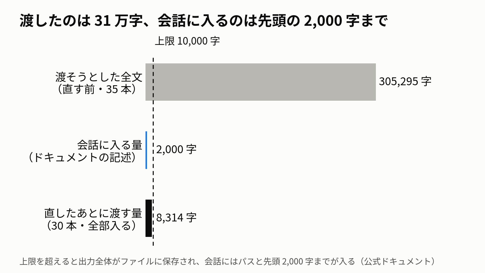
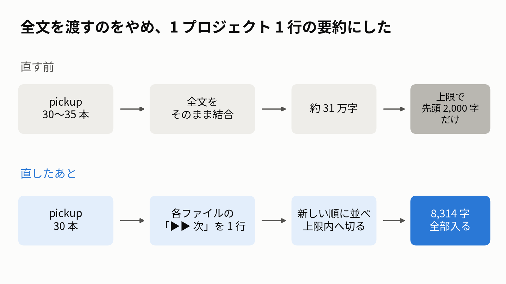
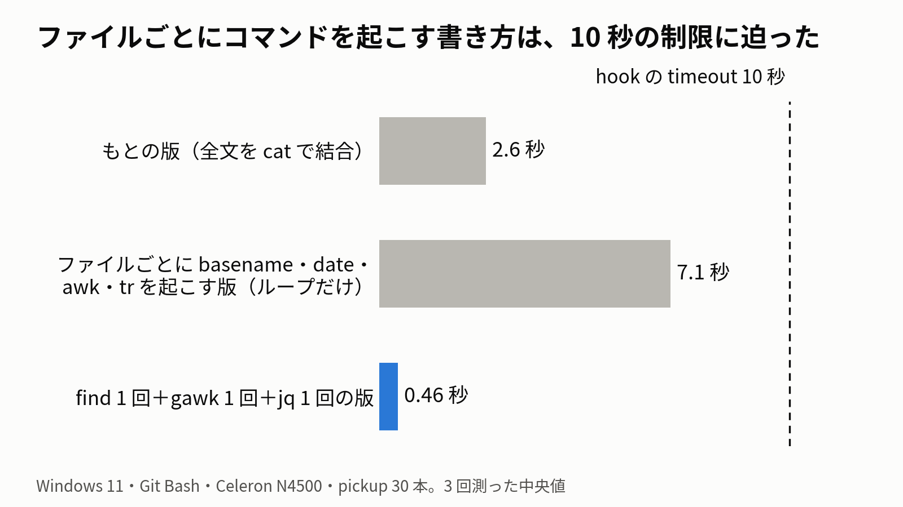
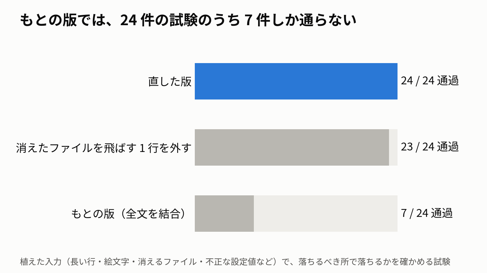

## きっかけ

Claude Code でいくつものプロジェクトを並行して進めていて、プロジェクトごとに「次にやること」を 1 つのファイルに書いています（以下、まとめて pickup と呼びます）。
会話を始めるたびに、SessionStart hook でその全部を Claude に渡していました。

PC の掃除のついでにメモを整理していて、pickup の量を測ったところ 53 万バイトありました。
hook が渡せる量には上限があったはずだと思い、調べてみました。

結論から書くと、hook が会話に渡せるのは 1 万字までで、それを大きく超えていた pickup は、会話の冒頭にほとんど入っていませんでした。
その確かめ方と直し方を残しておきます。

## 使っていた仕組み

SessionStart hook は、会話の開始時に動くコマンドです。
標準出力に JSON を返し、その中の `additionalContext` に入れた文字列が会話の文脈に入ります。

直す前の hook は、index（索引）と各 pickup の全文を順に `cat` でつないで返すだけでした（簡略化しています）。

```bash
#!/usr/bin/env bash
DIR="$HOME/.claude/memory"
content=$(cat "$DIR/pickup-queue.md")
while IFS= read -r -d '' f; do
  content="$content"$'\n\n'"$(cat "$f")"
done < <(find "$DIR/pickup-queue" -maxdepth 1 -type f -name '*.md' -print0 | sort -z)

printf '%s' "$content" | jq -Rsc '{
  hookSpecificOutput: {hookEventName: "SessionStart", additionalContext: .}
}'
```

## 渡していたのは 31 万字、会話に入るのは先頭の 2,000 字まで



公式の hooks のドキュメントには、次のように書かれています。

> A hook's `additionalContext`, `systemMessage`, and `initialUserMessage` strings, and its plain stdout, are capped at 10,000 characters

> Claude Code saves the output to a file in the session directory. It replaces the output with the file path and a preview of up to the first 2,000 characters.

> Unlike that Bash ceiling, this cap has no setting or environment variable to raise it.

つまり 1 万字を超えると、出力全体がファイルに保存され、会話に入るのはそのファイルのパスと先頭 2,000 字までのプレビューだけになります。
上限を引き上げる設定はありません。

直す前の hook が渡そうとしていた全文（index と pickup 35 本）は 305,295 字でした（UTF-16 で数えた値）。上限の約 30 倍です。
先頭は index なので、プレビューに入るとしても index の書き出しだけで、各プロジェクトの「次にやること」までは届きません。

なお、この調査をしていた会話の冒頭を見返すと、プレビューらしきものも含めて pickup 由来の文字は見当たりませんでした。
ドキュメントの説明（プレビューが入る）とは合いませんが、理由は確かめていません。

## 記録の残る 5 月から、ずっと 1 万字を超えていた


いつから超えていたのかを、設定ファイルを控えている git リポジトリの履歴で数えました。
日ごとに最後のコミットを取り、その時点の index と各 pickup の字数を UTF-16 で足しています。

```bash
git log --format='%h %ad' --date=short | awk '!seen[$2]++' | sort -k2 |
while read h d; do
  files=$(git ls-tree -r --name-only "$h" |
          grep -E '^memory/pickup-queue\.md$|^memory/pickup-queue/[^/]+\.md$')
  [ -z "$files" ] && continue
  chars=$(for f in $files; do git show "$h:$f"; done |
          jq -Rs 'explode | map(if . > 65535 then 2 else 1 end) | add')
  echo "$d $chars"
done
```

記録が残る最初の日（5 月 10 日）でも 14,559 字で、すでに 1 万字を超えていました。
7 月 7 日より前の控えには index と pickup 1 本しか入っていないので、グラフの 7 月の段差はそのためです。
その後はプロジェクトが増えるにつれて伸び、11 月 12 日には 305,295 字になっていました。

なお、Claude Code の上限がいつから 1 万字だったのかは確かめていません。
「ずっと届いていなかった」とまでは言えず、言えるのは「記録の残る範囲では、ずっと 1 万字を超えていた」までです。

## 確かめ方 1：hook の出力を UTF-16 で数える

上限の 1 万字は JavaScript の文字列の長さ、つまり UTF-16 の単位で数えている前提で測りました（ドキュメントは単位を書いていないので、ここは私の前提です）。
絵文字は UTF-16 では 2 と数えるので、`jq` の `length`（コードポイントの数）より少し大きくなります。

```bash
bash ~/.claude/hooks/inject-pickup-queue.sh |
  jq '.hookSpecificOutput.additionalContext
      | [length, (explode | map(if . > 65535 then 2 else 1 end) | add)]' -c
```

記事を書いた時点で、直す前の hook（pickup 30 本）は `[275902,276362]` でした。
コードポイントでは 275,902、UTF-16 では 276,362 です。

ついでに分かったことですが、Git Bash の `wc -m` は UTF-16 の単位で数えていました（`printf 'a😀b' | wc -m` が 4）。
最初はこれを「コードポイントの数」だと思い込んでいて、後で数え直しました。

## 確かめ方 2：新しい会話に「冒頭に何が見えるか」を聞く

字数が上限内でも、本当に会話に入っているかは別の話です。
`claude -p` で新しい会話を 1 つ開き、冒頭にあるはずの見出しが見えるかを聞きました。

```bash
claude -p "この会話の冒頭の文脈に『Pickup Queue（自動 inject・要約）』という見出しがありますか。\
あれば、その直後の『- 』で始まる行を最初の 3 行だけそのまま書いてください。\
無ければ『無い』とだけ答えてください。ツールは使わないでください。" --max-turns 1
```

直したあとの hook では「あります」と答え、hook が出した 3 行をそのまま書き返してきました。
直す前の hook では、この確かめ方は試していません。

## 直し方：全文をやめ、1 プロジェクト 1 行の要約にした



会話の冒頭に要るのは、全文ではなく「どのプロジェクトがあって、それぞれ次に何をするか」でした。
そこで各ファイルから 1 行だけ取り出して並べる形にしました。

1 行の選び方は次のとおりです。

- 「▶▶」を含む最初の行（「（旧）」と書いた古い行は除く）
- その行が見出しだけで短い（70 字未満）ときは、続く中身の行を 2 行までつなげる。見出し・区切り線・「✅」で始まる済んだ行は飛ばし、次の見出しに来たらやめる
- 「▶▶」が無ければ「▶」か「⏳」の行、それも無ければ frontmatter の `description`、それも無ければ最初の本文の行

並べ方は更新の新しい順にしました。最近触ったプロジェクトほど上に来ます。
全文は各ファイルに残してあるので、作業に入るときにそのファイルを読めば足ります。

出力はこのような形になります（例は架空のものです）。

```text
# Pickup Queue（自動 inject・要約）
各プロジェクトの「次」を 1 行ずつ、更新の新しい順に並べたもの（行は途中で切ってある）。…

- garden-sensor（11-12）: ▶▶ 次＝土の水分センサーの値が夜だけ跳ねる原因を、配線を替えて確かめる
- recipe-site（11-10）: ▶▶ 次＝検索結果の並び順を、作った日ではなく評価順にする
- photo-backup（10-21）: ⏳ 残り：外付けディスクの交換後、1 回目の同期が終わったかを見る
```

上限に収めるところは `jq` で書きました（一部省略しています。`header`・`footer`・`$limit` は別に定義しています）。
1 行の長さを 400 字から少しずつ縮めて、UTF-16 で上限内に入った最初の長さを使います。
それでも入らないときは、古い順に行を落とし、落とした件数を最後に書き添えます。

```jq
def u16: explode | map(if . > 65535 then 2 else 1 end) | add // 0;
def cut($n): if length > $n then .[0:$n] + "…" else . end;
def render($items; $n): header + ($items | map("- " + .s + "（" + .d + "）: " + (.t | cut($n))) | join("\n")) + footer;
def omitted($k): if $k > 0 then "\n- （ほか " + ($k|tostring) + " 件は字数の上限で省略）" else "" end;
def fit($items; $k): (render($items; 20) + omitted($k)) as $o
  | if ($o | u16) <= $limit or ($items | length) == 0 then $o else fit($items[:-1]; $k + 1) end;

(first((400, 320, 260, 220, 180, 150, 120, 90, 60, 40, 20) as $n
       | render($items; $n) | select(u16 <= $limit))
 // fit($items; 0))
```

上限は 9,500 字にして、1 万字との間に少し余裕を残しました。
直したあとの出力は pickup 30 本で 8,314 字です（UTF-16）。
直す前の 35 本から 30 本に減っているのは、この作業の途中で、終わったプロジェクトの pickup 5 本を別のフォルダへ移したためです。

## ファイルごとにコマンドを起こす書き方は、10 秒の制限に迫った



最初に書き直した版は、ファイルごとに `basename`・`date`（2 回）・`awk`・`tr` を起こしていました。
手元で測ると 8.5 秒かかっていました。
これを別の Claude（Opus）にレビューさせたところ、settings.json ではこの hook の timeout が 10 秒になっていると指摘されました。
timeout を超えたときにどうなるかは試していませんが、10 秒に対して余裕がありません。

そのループの部分だけを切り出して測り直すと 7.1 秒（3 回の中央値）でした。
30 ファイル × 5 個＝150 回コマンドを起こしているので、1 回あたり約 47 ミリ秒です。
もとの全文を `cat` でつなぐ版は 2.6 秒です。

そこで、コマンドを起こす回数がファイルの数で増えない形にしました。

- 更新日時とパスは `find -printf` で一度に取る
- 1 行を取り出す処理は、全ファイルを 1 回の `gawk` で読む（`BEGINFILE`／`ENDFILE`／`nextfile`）
- 整形と字数の調整は 1 回の `jq`

```bash
mapfile -t META < <(find "$SECTIONS_DIR" -maxdepth 1 -type f -name '*.md' \
                      -printf '%T@\t%Tm-%Td\t%p\n' | sort -t$'\t' -k1,1nr -k3,3)
FILES=(); for m in "${META[@]}"; do FILES+=("${m##*$'\t'}"); done

printf '%s\n' "${META[@]}" | LC_ALL=C.UTF-8 gawk '
  BEGINFILE {
    if (ERRNO != "") { done = 1; nextfile }   # find のあとに消えたファイルは飛ばす
    ...
  }
  FILENAME == "-" { split($0, a, "\t"); day[a[3]] = a[2]; next }   # 標準入力で日付を受け取る
  ...
' - "${FILES[@]}" | jq -Rsc '...'
```

これで 0.46 秒（3 回の中央値）になりました。

途中で踏んだものを 3 つ書いておきます。

- `find -printf` の `%TM` は「月」ではなく「分」でした。月は `%Tm` です。
- `gawk` は、ロケールが UTF-8 でないと `length` がバイト数を返します（「あいう」で 9）。
- `BEGINFILE` を書いた `gawk` は、開けないファイルに当たると止まり、そのあとのファイルを読みません。`find` と `gawk` の間にファイルが消えると、それより後ろのプロジェクトが全部消えます。`ERRNO` を見て飛ばすようにしました。

## 植えた入力で、落ちるべき所で落ちるかを確かめた



hook には試験を 24 件つけました。
本物の pickup に対しては「3 秒以内に終わる」「UTF-16 で 9,500 字以内」「ファイル数と行数が同じ」を見ます。
それ以外は、作業用のディレクトリに入力を植えて確かめます。

- 「（旧）▶▶」の行を飛ばす／見出しだけの行に続きをつなげる／次の見出しで止まる
- 本文が区切り線（`---`）で始まっても frontmatter と取り違えない／折りたたんだ `description: >` を読む
- `_archive/` の下は出さない／新しい順に並ぶ
- 上限に不正な値（`abc`・`10`・`-5`・空）を入れても、出力が空にならない
- 絵文字だらけの長い行のファイルを 150 本置いても上限内に収まり、最後の手段（古い順に落とす）でも収まる
- 途中のファイルが消えても、後ろのファイルが残る

上限の試験が空振りしていないことも確かめました。
上限を外すと、植えた 150 本の出力は約 7.9 万字になります。
もとの版に差し替えると 24 件中 7 件しか通らず、消えたファイルを飛ばす 1 行だけを外すと 1 件が落ちます。

## まとめ

- Claude Code の hook が会話に渡せるのは 1 万字までで、超えると出力全体がファイルに保存され、会話には先頭 2,000 字までしか入りません。引き上げる設定はありません。
- 私の環境では、pickup を全文で渡していたため 31 万字になっていて、記録の残る 5 月からずっと 1 万字を超えていました。
- 1 プロジェクト 1 行の要約にして、更新の新しい順に並べ、UTF-16 で上限内に収める形にしたところ、8,314 字になり、新しい会話の冒頭に入ることを確かめられました。
- Windows の Git Bash では、ファイルごとにコマンドを起こすと hook の timeout（10 秒）に迫りました。`find` 1 回・`gawk` 1 回・`jq` 1 回にして 0.46 秒です。

hook で何かを会話に入れている場合、出力の字数を一度測っておくと、黙って切られていないかが分かります。私はそれまで一度も測っていませんでした。

## 付録

- 環境：Windows 11・Git Bash（GNU bash 5.2.37）・gawk 5.0.0・jq 1.8.1・GNU findutils 4.10.0・Claude Code 2.1.322・Celeron N4500（RAM 4GB）
- 上限の記述：[Claude Code hooks のドキュメント](https://code.claude.com/docs/en/hooks)（2026-11-12 に原文を確認）
- グラフの字数は「index と各 pickup の本文」の合計で、hook が足す見出しなどは含みません。
- 1 万字を数える単位（UTF-16 かコードポイントか）はドキュメントに書かれていないので、多いほうの UTF-16 で上限内に収めています。
- 実際の履歴の集計では、控えのリポジトリでのパスの前に PC 名のフォルダが付いている期間があり、その期間はそちらを使っています（上のコードでは省いています）。
