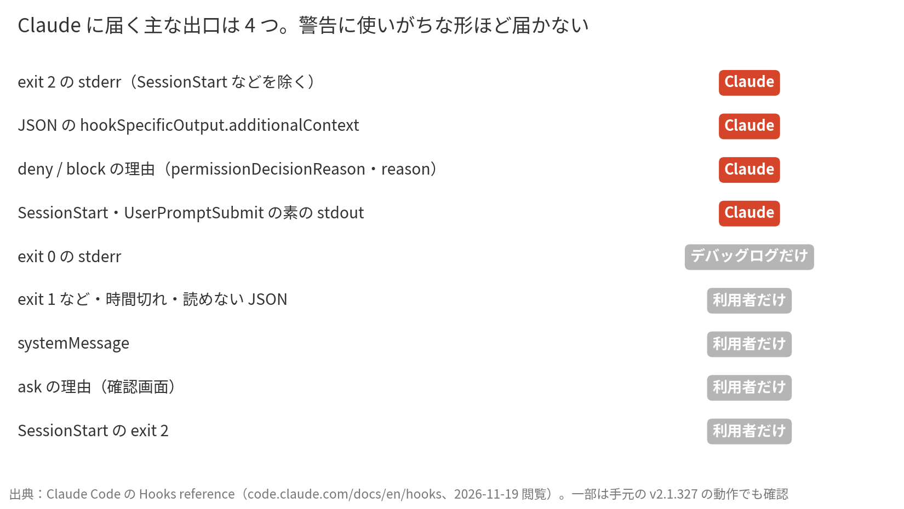
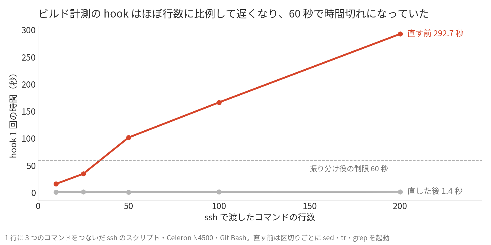
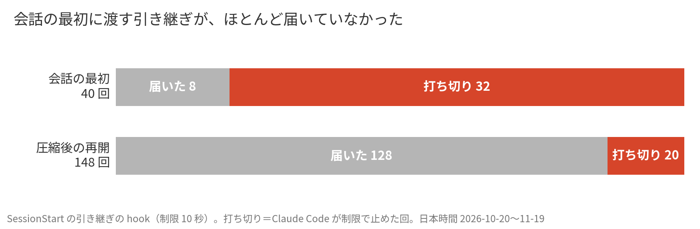

## きっかけ

Claude Code には hook という仕組みがあります。ツールを呼ぶ前や、返答を終える前などに自分のスクリプトを走らせて、危ない操作を止めたり、注意を出したりできます。私は Claude Code に頼んで hook を少しずつ増やしてもらい、気づくと 86 本になっていました。

あるとき、画面には hook の警告やエラーが出ているのに、Claude がそれに一言も触れずに作業を続けていることに気づきました。警告は私の画面には出ていても、Claude には届いていないように見えます。私にしか見えない警告では、意味がありません。

そこで、どの出し方なら Claude に届くのかを公式ドキュメントで確かめ、手元の hook を見直しました。この記事はその記録です。

## 環境

- PC：Windows 11・Celeron N4500・メモリ 4GB
- シェル：Git Bash（hook はすべて bash スクリプト）
- Claude Code：v2.1.327（記録を見返した 1 か月は v2.1.304〜2.1.327）
- hook：86 本
  - PreToolUse 55 本。settings.json には振り分け役を 1 本だけ書き、そこから最大 8 本ずつ呼ぶ
  - Stop 17 本・SessionStart 5 本・UserPromptSubmit 3 本・PostToolUse と PostToolUseFailure 6 本

hook はどれも、私が Claude Code に「こういうときは止めて」と頼んで書いてもらったものです。

## Claude に届く主な出口は 4 つ



公式の Hooks reference を読むと、hook の出力のうち Claude に届く主なものは次の 4 つでした。

- exit 2 で終わったときの stderr（SessionStart などの一部のイベントを除く）
- JSON で返す `hookSpecificOutput.additionalContext`
- 止めたときの理由（`permissionDecisionReason` の deny、`decision: "block"` の `reason`）
- SessionStart と UserPromptSubmit の、素の stdout

逆に、警告を出すときに使いがちな形は届きません。

- **exit 0 で stderr に書いた警告**：ドキュメントには「Claude never sees stderr from a hook that exits 0」とあります。自分で読むにはデバッグログを有効にするように、と続きます。
- **exit 1 などで落ちたとき・時間切れ・読めない JSON**：止めない失敗として扱われ、PreToolUse などでは画面に「hook error」と出るだけで、操作はそのまま進みます。
- **Stop や PostToolUse などの素の stdout**：素の stdout を Claude に渡すのは、SessionStart や UserPromptSubmit などの一部のイベントだけです。
- **`systemMessage`**：利用者向けの警告です。
- **ask（確認）の理由**：利用者の確認画面にだけ出ます。
- **SessionStart の exit 2**：表には「Shows stderr to user only」とあります。

私の hook は、「止めるほどではないので exit 0 で stderr に警告を出す」という作りが多く、そのままだと全部どこにも届いていませんでした（振り分け役のほうで先に手当てしていた分を除く）。

## 届かないだけでなく、チェック自体が走っていなかった

会話の記録を見返すと、画面に「hook error」などと短く出ていたものの多くは、hook が時間内に終わらなかった跡でした。こうなった hook は、Claude に何も伝えないだけでなく、守るはずだったチェックそのものをしていません。

ここからは言葉を 2 つ使い分けます。**時間切れ**は、私の振り分け役や実行役が自分の制限で hook を止めたもの（記録では止めない失敗）。**打ち切り**は、Claude Code が設定の制限で hook を止めたもの（記録では `hook_cancelled`）です。

## 具体例 1：ビルド計測の hook は、行数に比例して遅くなっていた



時間切れでいちばん多かったのは、1 本の hook でした。RPi5 にビルドやテストを投げるコマンドに、メモリ計測の `peakrss` を付け忘れていないかを見る hook です。

この hook は、コマンドを `;` や `&&` や `|` や改行で区切り、区切った 1 つずつを `sed`・`tr`・`grep` に通して先頭の語を調べていました。Git Bash では、プログラムを 1 回起動するたびに時間がかかります。区切り 1 つあたり十数回の起動が積み重なっていました。

上の図は、1 行に 3 つのコマンドをつないだ ssh のスクリプトを、行数を変えて渡したときの時間です（行数ごとに 1 回ずつ測った値）。直す前は 10 行で 16 秒、50 行で 101.5 秒、200 行で 292.7 秒かかりました。実際の運用では振り分け役が 60 秒で打ち切るので、25 行と 50 行のあいだのどこかから先は、チェックそのものが走らなくなっていたことになります。

直し方は、区切ったあとの処理を bash の組み込み（`[[ =~ ]]` と `BASH_REMATCH`、パラメータ展開）だけで書き直すことでした。200 行でも 1.4 秒です。判定の規則は変えておらず、既存の試験 47 件はすべて同じ結果になりました。

```bash
# 直す前（1 行ごとにプログラムを起動）
piece=$(printf '%s' "$piece" | tr -d '"'"'"'`' | sed -E 's/^[[:space:]]+//')

# 直した後（bash の中だけで処理）
piece=${piece//[\"\'\`]/}
[[ $piece =~ ^[[:space:]]+(.*)$ ]] && piece=${BASH_REMATCH[1]}
```

## 具体例 2：会話の最初の引き継ぎが、ほとんど届いていなかった



SessionStart では、前の会話からの引き継ぎ（次にやることの一覧）を Claude に渡す hook を走らせています。SessionStart は会話の最初だけでなく、会話が長くなって圧縮されたあとの再開でも走ります。この hook の制限は 10 秒で、記録を見ると、会話の最初ではほとんどの回で打ち切られていました。圧縮後の再開では、打ち切りは一部だけです。

会話の最初のほうが打ち切られやすいのは、Claude Code 自身の起動と重なって PC が一番忙しい時間だからだと思います。届かなかった回の Claude は、引き継ぎを知らないまま会話を始めていたことになります。

同時に走る他の 3 本（資格情報の置き場所の点検、設定の乗っ取り点検、RPi5 のディスクの確認）も、制限 15 秒で何度も打ち切られていました。この 3 本は何も見つからなければ黙って終わる作りなので、打ち切られても、画面に短い表示が出る以外は何も起きません。

原因は、遅い PC で 5 本を一斉に起動していることと、制限が短いことでした。

## 具体例 3：Stop の hook 17 本が一斉に起動して、落ちていた

返答を終える前の Stop には 17 本の hook があります。ドキュメントにあるとおり、同じイベントの hook は並列に走るので、17 本が一度に起動します。メモリ 4GB の PC では、Git Bash がプロセスを作れずに落ちることがあり、記録には次のようなエラーが残っていました。

```text
child_copy: cygheap read copy failed
/usr/bin/bash: Resource temporarily unavailable
```

原因が読めたものは、どれもプロセスを起動できなかった失敗です（上の 2 つのほか、`uv_spawn` の `EUNKNOWN`、git の起動の失敗など）。stderr が空で、記録からは原因が分からないものも多くありました。どの場合も止めない失敗として扱われるので Claude には何も届かず、チェックが最後まで走ったかどうかも分かりません。

## 直し方：hook を包む実行役を 1 本はさむ

hook を 1 本ずつ直すのではなく、全部の hook を包む実行役 `run-hook.sh` を書きました。settings.json では、元の hook の前にこれをはさみます。

```json
{
  "type": "command",
  "command": "bash 'C:/Users/me/.claude/hooks/run-hook.sh' Stop 290 'C:/Users/me/.claude/hooks/block-stop-on-paid-proposal.sh'",
  "timeout": 300
}
```

実行役がしていることは 4 つです。

1. **同時に走る数を絞る**。機械全体で 8 本まで。PreToolUse の振り分け役と同じ枠を使う
2. **すぐ落ちたら 1 回だけやり直す**。プロセスを作れない失敗は一時的なので、15 秒以内に落ちたときだけ
3. **それでも落ちた・時間切れになったときは、Claude に届く形で知らせる**
4. **Claude に届かない出し方を、届く出し方に置き換える**

3 と 4 は、hook の出し方ごとにこう決めました。

- 落ちた・時間切れ → `additionalContext` で「このチェックは走らなかった」と知らせる
- exit 0 で stderr に出した警告 → `additionalContext` に入れる
- `systemMessage` だけ → 同じ文を `additionalContext` にも入れる
- SessionStart の exit 2 → `additionalContext` に入れる
- Stop・PostToolUse の素の stdout → `additionalContext` に入れる
- exit 2・JSON の判定 → そのまま通す

PreToolUse の振り分け役にも同じ手当てを入れ、ask（確認）の理由も `additionalContext` に写すようにしました。確認画面で何を聞かれたのかを、Claude も知っておけるようにするためです。

失敗を知らせる部分は、たとえばこうなっています。

```bash
fail_out() {  # $1 = 原因の種類, $2 = 理由
  local msg="[$name] HOOK FAILED ($event): $2. This check did not run; do what it would have checked yourself."
  report "$1" && say_json "$msg"   # say_json = {"hookSpecificOutput":{"hookEventName":..,"additionalContext":..}}
  exit 0
}
```

制限も見直しました。Claude Code が hook に与える時間を、SessionStart と UserPromptSubmit は 60 秒、Stop は 300 秒にしています。実行役は、その少し手前で自分から hook を止めて、時間切れを知らせます。Claude Code に打ち切られてしまうと、実行役も何も言えないからです。

## 直したら、隠れていた警告が出てきた

実行役を入れた直後から、これまで見えていなかった警告が Claude に届き始めました。

- bash の「`warning: command substitution: ignored null byte in input`」。ツールの出力に NUL 文字が混じっていると出ます。情報だけの警告なので、この 1 行は届けない対象にしました
- 一時フォルダにスクリプトを書くたびに出ていた「ローカル処理禁止」の警告。一時フォルダは `/tmp` と同じ扱いでよい場所なので、誤報でした。対象から外したついでに、`claude/../../Desktop/x.py` のように `..` を挟むと外側に書ける穴も見つけて塞ぎました

届くようになって初めて、誤報も直せるようになりました。

## Stop で知らせると、次の Stop は「続きの中」になる

Stop の hook が `additionalContext` を返すと、ドキュメントのとおり会話が続きます。では、そのあとの Stop で `stop_hook_active` はどうなるのか。ドキュメントには「true when Claude Code is already continuing as a result of a stop hook」とあるだけだったので、記録を取るだけの hook を一時的に入れて測りました。

```text
13:38:06 stop_hook_active=absent   ← 1 回目の Stop（ここで additionalContext を返した）
13:39:41 stop_hook_active=true     ← 続きのあとの Stop
```

1 行目の `absent` は、記録の取り方の都合です。jq の `.stop_hook_active // "absent"` は、値が false のときも `absent` を返します。2 行目からは `has()` で書き直してあり、続きのあとの Stop では true でした。私の Stop hook のうち 3 本は「`stop_hook_active` が true なら見送る」という作りだったので、別の hook が知らせを 1 つ出しただけで、次の 1 回は判定をやめていたことになります。「自分が直前に止めたときだけ見送る」に作り直しました。Claude Code には、Stop の hook が 8 回続けて会話を続けさせたら、次は止めずに返答を終える上限もあります。この回数は、Claude がツールを呼ぶと数え直されます。

## Stop の時点では、記録に最後の返答が入っていないことがある

ドキュメントの Stop の節には、もう 1 つ大事なことが書いてありました。Stop の時点では、会話の記録に最後の返答が入っているとは限らないので、入力の `last_assistant_message` を使うように、という注意です。

私の Stop hook は 17 本とも、最後の返答を会話の記録から読んでいました。記録を取る hook で 2 回比べたところ、手元ではどちらも一致しましたが、保証はありません。記録の書き込みが遅れたときの動きを偽の記録で試すと、次の 2 本が実際に誤った判定をしました。

- エラーのあと、利用者に質問を投げて止まるのを防ぐ hook：最後の返答を見られず、素通りした
- エラーを報告せずに終わるのを防ぐ hook：最後の返答でエラーに触れていたのに、止めた

返答の文面を見る 12 本を、`last_assistant_message` を優先して読む形に直しました。

## 確かめたこと

- 振り分け役：偽の hook 7 通り（落ちる、1 回目だけ落ちる、時間切れ、確認と落ちるの組み合わせ、止めると落ちるの組み合わせ、警告だけ、何もなし）
- 実行役：偽の hook 26 通り
- ビルド計測の hook：試験 53 件（`ssh -i 鍵` のような引数つきのオプションの見逃しも、ついでに直した）
- 本物の hook を同時に走らせる通しの確認：Stop 17 本が全部完走して 24 秒、SessionStart 5 本が 12 秒
- 直したあとの会話で、確認の理由や PostToolUse の警告が、実際に Claude に届いていること

## まとめ

今回の環境では、Claude Code に作ってもらった hook の多くが、Claude に届かない形で警告を出していました。そして遅い PC では、hook そのものが時間内に走りきれていませんでした。どちらも私の画面に短く出ただけで、Claude は知らないまま作業を続けていました。

個人的に一番の発見は、警告が届かないことより、走らなかったチェックが「走らなかった」と誰にも伝わらないことでした。私は hook が守ってくれているつもりでいたので、この抜けに気づけませんでした。

自分の環境で同じことが起きていないかは、会話の記録から確かめられます。やり方は付録に書きました。

## 付録

### 用語

- **PreToolUse / PostToolUse**：ツールを呼ぶ前／呼んだ後に走る hook
- **Stop**：Claude が返答を終える前に走る hook。exit 2 で止めると、Claude は作業を続ける
- **SessionStart / UserPromptSubmit**：会話の始まり／利用者が文を送ったときに走る hook
- **additionalContext**：hook が JSON で返す、Claude 向けの文。システムからの注記として Claude に渡る

### 自分の環境で確かめる

Claude Code は会話の記録を `~/.claude/projects/<プロジェクト>/<会話 ID>.jsonl` に 1 行 1 件の JSON で残します。hook の結果も `attachment` として入っていて、種類（`type`）のうち次の 3 つは Claude には渡っていません。

- `hook_non_blocking_error`：止めない失敗（exit 1 や時間切れ）
- `hook_cancelled`：Claude Code が打ち切った
- `hook_system_message`：`systemMessage`（利用者向けの警告）

イベントと hook ごとに数えるなら、次のようにしました。

```jq:count.jq
select(.attachment?)
| .attachment
| select(.type == "hook_non_blocking_error" or .type == "hook_cancelled" or .type == "hook_system_message")
| [ .type, (.hookEvent // ""), ((.command // .hookName // "") | split("hooks/") | last) ]
| @tsv
```

```bash
cat ~/.claude/projects/<プロジェクト>/*.jsonl \
  | jq -r -f count.jq \
  | sort | uniq -c | sort -rn
```

### 注意

- 私の環境（遅い PC・hook 86 本）での話です。速い PC や hook の少ない環境では、時間切れはずっと少ないと思います
- 成功の記録は hook が何か出力したときしか残らないので、黙って終わる hook が毎回最後まで走ったかは、記録からは分かりません
- hook の扱いは Claude Code の版で変わることがあります。記録を見返した期間は v2.1.304〜2.1.327、直したあとの確認は v2.1.327、ドキュメントは 2026-11-19 に読んだものです

### 参考

- [Hooks reference](https://code.claude.com/docs/en/hooks)
- [Automate actions with hooks](https://code.claude.com/docs/en/hooks-guide)
