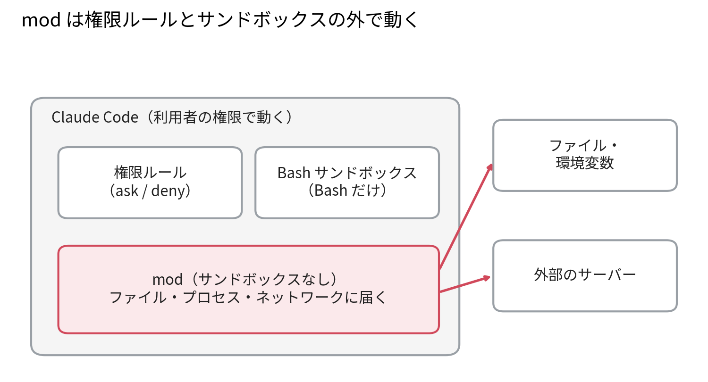

## きっかけ

Claude Code に 2026-10-01、mods という仕組みが入りました。TypeScript の小さな関数で、Claude Code の動き方や画面を変えられるものです。

私は正式版の前の試験版（`CLAUDE_CODE_ENABLE_FUNCTION_HOOKS=1` で有効にする function hooks）で、mod を 1 本自作していました。しばらく放置すると 1 回だけ compact し、要約に「続きメモ」を書かせるものです。ところが、起動直後にエラーが出てセッションが落ちることがあり、原因を切り分けるまで読み込まないようにしています。

正式版が出たので入れ直す前に、mods が何をでき、何に気をつけるべきかを調べました。この記事はその備忘録です。

調べたのは 2026-11-23 です。公式の紹介記事と公式ドキュメント（mods の overview・admin・troubleshoot、プラグインの security・loading・org、permissions）と、後半で触れる第三者の記事 5 本は、原文を読んでいます。mods は出てから 2 か月足らずで、仕様がよく変わります。

## 環境

- Windows 11
- Claude Code v2.1.330
- ログインは個人の Max プラン。managed settings のファイルは置いていない
- 危ない操作を止める hook を設定ファイルにたくさん書いていて、auto mode で使っている
- 自作の mod 1 本（いまは読み込んでいない）

## mods でできること

公式の紹介記事では、mods は「small TypeScript functions that change how Claude Code works」と紹介されています。公式ドキュメントでは、ツール呼び出しやプロンプトの送信、画面の描画などの出来事に Claude Code が mod の関数を呼び、mod はそれを見る・変える・引き取る、と説明されています。

できることは、たとえば次のとおりです。

- 会話の横にペインを出したり、入力欄の上に帯を出したりする（タブ・ボタン・入力欄つき）
- ツール呼び出しの行やスピナー、質問の画面など、Claude Code 自身の表示を描き直す
- ツール呼び出しを止めて利用者に質問する、ツールを動かさずに答える
- Claude へのリクエストを 1 回だけ別のモデルに送る
- Claude を通さずに自分の関数を動かす `/command` を足す

mod はプラグインの中に入れて配ります。`hooks/hooks.json` の `modules` に JavaScript か TypeScript のファイルを書きます。ビルドは要りません。Claude に頼めば、書いて、入れて、そのまま読み込み直すところまでやってくれます。

Claude Code の機能の一部も、すでに mod で作られています（組み込みの mod）。`/plugin` の Installed タブの Built-in に出ます。

- `cc-plugin-agents-md`：AGENTS.md の読み込み
- `cc-plugin-diff`：ターミナルの `/diff`
- `cc-plugin-sec-default`：組織が管理する設定を、利用者の入れた mod から守る（止められない）
- `cc-plugin-telemetry`：利用データの送信
- `cc-plugin-you-should-know`：見落としの指摘（既定では無効）

既定で有効になるのは、ターミナルが v2.1.287 から、デスクトップアプリが v2.1.286 からです。

## mod はサンドボックスの外で、自分の権限で動く



調べていちばん大事だと思ったのはここです。紹介記事には「They aren't sandboxed, and you should only install mods from sources you trust」とあります。公式の overview には、読み込まれた mod ができることが並んでいます。

- 自分のユーザーとして、どこでもファイルを読み書きし、プログラムを起動し、ネットワークに接続する
- 環境変数や設定ファイルにある API キーを読む
- 送ったすべてのプロンプトと、Claude のすべてのツール呼び出しを見る
- プロンプトやツール呼び出しを書き換える。自分が打ったかのようにプロンプトを送る
- 聞かれる前にツール呼び出しを許可する
- 自分のプランや API キーでモデルを呼ぶ

Claude Code のサンドボックスが囲うのは、Claude が実行する Bash だけです。mod が起動したプロセスはその外で動きます。

これまでの hook（設定ファイルに書くシェルのコマンドなど）は、Claude Code の外で動くものでした。mod は Claude Code 自身のプロセスの中で呼ばれる関数です。公式の比較表でも、mod は「Functions in a plugin that Claude Code calls in its own process」と書かれています。

## 私の環境では、守りの組み込み mod が読み込まれない

ここが特に自分に関係していました。

組み込みの `cc-plugin-sec-default` が読み込まれるのは、次のどちらかのときだけです。

- その機械に managed settings（か `managed-mcp.json`）がある
- Team か Enterprise のプランで `/login` している

私は個人の Max プランで、managed settings も置いていません。つまり、この守りは読み込まれていません。

公式の permissions のページには、この構成のときに mod ができることが書いてあります。

- 自分の PreToolUse hook が止めた呼び出しと、deny ルールが拒む呼び出しの一部を許可できる
- ask ルールや PreToolUse hook の確認を飛ばせる
- auto mode では、mod が許可した呼び出しは分類器（自動承認の判定）を通らずに動きうる

私は危ない操作を止めるための hook をたくさん書いて、auto mode で使っています。そこへ人の書いた mod を 1 本入れると、その mod は hook の判定を上書きできるということです。

守りが読み込まれていても、mod 自身が呼ぶ `$.fs` や `$.process` は権限ルールと PreToolUse hook を通らずに済みます。admin のページには、`Read(.env)` を deny にしていても、mod は `$.fs.read` でそのファイルを読める、と例が書かれています。

例外もあります。mod は権限の確認画面の中身を変えられません。また、AskUserQuestion のように利用者の操作が必要なツールは、mod が許可しても確認が出ます（v2.1.292 から）。

## 壊れた mod は飛ばされる

公式の troubleshoot のページには「When a mod's module or one of its hooks fails, Claude Code skips it and the session continues, so a broken mod can look like one that does nothing.」とあります。

- hook が例外を出す、時間切れになる、決まった形でない結果を返すと、その hook は飛ばされる
- mod を動かす裏の処理（hooks worker）が 3 回止まって原因の mod を特定できないときは、そのセッションでは組み込み以外の mod が全部外れる。組織が入れたものも外れる。`/reload-plugins` で読み込み直せる

止める役の mod を入れても、それが壊れていれば何も止まりません。

## 手元で `claude plugin validate` を走らせると、mod が触るものが一覧で出た

自作の mod に `claude plugin validate` をかけてみました。これはコードを動かさずに中身を読む検査です。

```text
❯ ./idle-compact-memo.ts hooks: turn.start, turn.complete, session.compact, session.end
❯ ./idle-compact-memo.ts gating hook without .catch: session.compact
❯ ./idle-compact-memo.ts calls: $.clock.after (via arm), $.clock.now (via arm, fire, writeMemo),
  $.fs.exists (via writeMemo), $.fs.write (via writeMemo), $.session.compact (via fire),
  $.session.cwd (via writeMemo), $.session.id (via arm, fire), $.ui.log (via log, notice)
```

公式の overview によると、`hooks:` の行は mod が受け持つ出来事、`calls:` の行は mod が Claude Code に頼むことです。私の mod はファイルに書き込み（`$.fs.write`）、compact を起こします（`$.session.compact`）。ネットワークは使っていません。

admin のページには、気にしたい呼び出しの表もありました。たとえば `$.fs.read` と `$.fs.write` はどこでも読み書きできること、`$.env.get` は API キーが入りうる環境変数を読むこと、`$.model.complete` は自分のプランや API キーでモデルを呼ぶことを意味します。人の書いた mod を入れるときは、まずこの 2 行と表を突き合わせるつもりです。ただ、これは静的な検査なので、ソースも読みます。

`gating hook without .catch` という警告も出ました。止める役の hook に、失敗したときの処理が無いことを指しているようです。hook が失敗すると飛ばされるので、入れ直す前に `.catch` を足します。

## 試験版の環境変数は、もう効かない

overview には、試験版のときに `CLAUDE_CODE_ENABLE_FUNCTION_HOOKS` を設定していたら消すように、とあります。v2.1.287 以降はこの変数を見ないので、`0` にしても mods は止まりません。

私の mod は、この変数と、プラグインの置き場所を指す環境変数を両方消して読み込まないようにしています。止まっているのは置き場所の指定を消したからで、`CLAUDE_CODE_ENABLE_FUNCTION_HOOKS` を消したからではありませんでした。

## 公開されている mod の 4 割はプロセスを起動する


セキュリティ会社の Manifold Security が、GitHub で公開されている mod 6,125 本を調べています。41% がローカルのプロセスを起動し、32% がすべてのツール呼び出しを、29% がすべてのプロンプトを見ていました。

数えたのは、正式版から 3 週間あまりの 2026-10-25 時点で、いちばん大きな公開一覧に載っていたものです。ほかにも、次のことが書かれていました。

- 36% が環境変数を、35% がファイルを読む。13% は利用者としてプロンプトを送れ、11% はネットワークに出る
- 267 本（4%）が権限の判定そのものに割り込み、そのうち 93 本は「許可」を返せる
- 約 20 本は、外のチャンネル（Telegram のボットや中継サーバーなど）から動いているセッションにプロンプトを送れる
- 63 の repo の 223 本の mod は、GitHub から消えていた。利用者が入れたものを、もう誰も確かめられない
- 少なくとも 16 の repo が Claude の OAuth トークンを読んでいた。ただし調べた repo は、トークンを Anthropic にしか送っていなかった

## 正式版の前に、試験版で危ない例が示されていた

Pluto Security は 2026-09-22、正式版の前の試験版（v2.1.274）で、次のことができると示しました。

- `~/.claude/.credentials.json` とプロンプトの履歴を読み、外へ送る
- すべてに割り込む mod なのに、`plugin details` に「Hooks (0)」と表示される
- 入力欄のすぐ上に、偽の API キー入力欄を描く
- AskUserQuestion の画面で、質問文をすり替える（選択肢の名前は Claude Code が元に戻すが、「Confirm」「Cancel」のような一般的な名前だと見分けられない）
- 実際に動かすコマンドと、会話の記録に表示するコマンドを食い違わせる
- 入れたあとで、外から取ってきたコードを動かす

一方で、mod のコードは `fetch` や `require` を直接使えない場所で動くこと、ツールの許可を求める画面の表示は mod が書き換えられないことも確かめています。記事には「正式版の前の実装を試したもので、変わるかもしれない」と注記があり、正式版で同じことができるかは私は確かめていません。

## mods そのものではないが、近い出来事

- **AIR Security の Plugin4Shell（2026-09-17 公開・CVE-2026-86063）**：マーケットプレイスがプラグインを特定の commit（SHA）に固定していても、攻撃者がその SHA と同じ名前のブランチを作ると、git はブランチのほうを取り出してしまう問題です。プラグインの自動更新を通じて、利用者が何もしなくても届くとされています。Claude Code のほか Codex・Copilot・Gemini CLI も対象で、Claude Code は 2.1.179 以降で直っています
- **arXiv の HOOKPRY（査読前・2026-09-03 投稿）**：問題のないプラグインが、後の更新で攻撃者のコマンドを hook として黙って紛れ込ませる研究です。1,000 回の実行で、試した 7 つのエージェント実行環境すべてを乗っ取り、成功率は環境ごとに最大 92.5% でした。Microsoft Defender は 1 件も検出しなかったそうです
- **Cursor の拡張機能**：2026-10-29 の約 11 時間、Cursor の拡張機能の配布元に、改ざんされた Claude Code 拡張（2.1.312 と 2.1.313・Windows と macOS）が出ていました。SSH の裏口を仕込もうとするもので、多くの機械では管理者権限が無いため SSH を有効にする段階で失敗します。それでも攻撃者の SSH 鍵の追加、常駐の仕掛け、機械の情報の送信までは行われていました。Cursor は、Anthropic が作ったものではなく、正式な配布には影響の証拠が無いと書いています

公式の security のページにも、自動更新がオンのマーケットプレイスでは、確かめたあとのファイルがディスク上で変わりうる、と書かれています。自動更新の既定は、`claude-plugins-official` などの公式マーケットプレイスと claude.ai から追加したものがオン、それ以外はオフです（公式でも `knowledge-work-plugins` と `first-party-plugins` はオフ）。

## 私がどうするか

調べたうえで、自分の使い方はこうすることにしました。

- 入れるのは、自作の mod と組み込みの mod だけにする。守りの組み込み mod が読み込まれない環境なので、人の mod は自分の hook を飛ばせる前提で考える
- 人の mod を試したくなったら、`validate` の `hooks:` と `calls:` を見て、ソースを読んでから入れる。たくさんの mod をまとめたパックは入れない
- 公式以外のマーケットプレイスは、自動更新をオフのままにする
- 自作の mod は `.catch` を足し、起動直後に落ちる原因を切り分けてから読み込みを戻す

仕事で使う場合は、組織の managed settings で絞る設定が、admin と org のページにまとまっていました。

- `allowManagedModsOnly`（`pluginConfigs` の `cc-plugin-sec-default@builtin` の下）：利用者が自分で入れた mod を拒む。設定ファイルの hook やステータスラインはそのまま動く
- `allowManagedHooksOnly`：組織の mod と組み込みの mod だけを読み込む。利用者の設定ファイルの hook も止まる
- `disableAllHooks`：組織のものも含めて、組み込み以外のすべての mod と hook を止める。managed settings の PreToolUse hook も止まる
- `disableSideloadFlags`：起動時の `--plugin-dir` などを拒否し、セッション中に Claude が書いた mod も読み込ませない
- `prependPlugins`：組織の mod を先に動かす。ここを使うなら `sec-default@builtin` も並べないと、守りが外れる
- `strictKnownMarketplaces`：入れてよいマーケットプレイスの許可リスト
- `DISABLE_AUTOUPDATER`（managed の `env`）：プラグインの自動更新を止める。Claude Code 本体の更新も止まる。プラグインの自動更新だけ残すなら `FORCE_AUTOUPDATE_PLUGINS` を足す

## 確かめきれなかったこと

- 前の調べもので見かけた「200 本以上の mod をまとめたパック」と、公開されている mod の総数を数えている一覧のいまの件数は、確かめられなかったので入れていません

## 付録：出典

- 公式の紹介記事（2026-10-01）：https://claude.com/resources/articles/claude-code-mods
- mods の公式ドキュメント：https://code.claude.com/docs/en/plugins/mods/overview ／ admin ／ troubleshoot
- プラグインのセキュリティ：https://code.claude.com/docs/en/plugins/security
- プラグインの自動更新：https://code.claude.com/docs/en/plugins/loading
- 権限ルールと mod の優先順位：https://code.claude.com/docs/en/permissions
- 組織でのプラグイン管理：https://code.claude.com/docs/en/plugins/org
- Manifold Security：https://www.manifold.security/blog/agent-add-ons-approval-claude-code-mods
- Pluto Security：https://pluto.security/blog/claude-code-function-hooks-security/
- AIR Security（Plugin4Shell）：https://www.air.security/blog-posts/plugin4shell
- HOOKPRY：https://arxiv.org/abs/2609.03884
- Cursor のお知らせ：https://cursor.com/blog/claude-code-extension-security-notice
