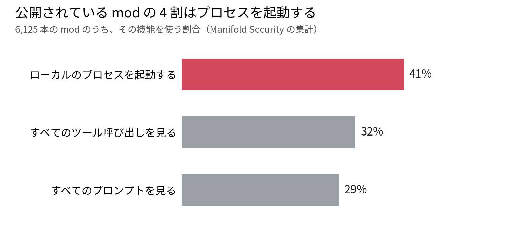

## きっかけ

2026-10-01、Claude Code に mods という仕組みが入りました。TypeScript の小さな関数を書くと、Claude Code の動きや画面を変えられるものです。この記事では、仕組みの名前を mods、1 本ずつを mod と書きます。

実は正式版の前、試験版の段階（`CLAUDE_CODE_ENABLE_FUNCTION_HOOKS=1` で有効にする function hooks）で、mod を 1 本作っていました。しばらく操作しないでいると 1 回だけ compact して、要約の中に、次に作業を再開するためのメモを書かせるものです。ところが起動直後にエラーが出てセッションが落ちることがあり、原因が分かるまで読み込まないようにしています。

正式版が出たので、入れ直す前に「mods で何ができるのか」「何に気をつければいいのか」を調べました。この記事はその備忘録です。

調べたのは 2026-11-23 時点の情報です。公式の紹介記事と公式ドキュメント、後半で紹介するセキュリティ会社などの記事は、どれも原文を読んでいます。mods は公開から 2 か月足らずで仕様がよく変わるので、ここに書いた内容も変わっているかもしれません。

## 環境

- Windows 11
- Claude Code v2.1.330
- 個人の Max プランでログイン。managed settings（組織が配る設定ファイル）は置いていない
- 危ない操作を止める hook を自分でたくさん書いていて、auto mode で使っている
- 自作の mod が 1 本（いまは読み込んでいない）

## mods でできること

公式の紹介記事は、mods を「small TypeScript functions that change how Claude Code works」と説明しています。ツール呼び出し、プロンプトの送信、画面の描画といったタイミングで Claude Code が mod の関数を呼び、mod はその処理を見たり書き換えたり、代わりに自分で処理したりできます。

たとえば、こんなことができます。

- 会話の横にペインを出す、入力欄の上に帯を出す（タブやボタン、入力欄も置ける）
- ツール呼び出しの表示やスピナー、質問の画面など、Claude Code 自身の画面を描き直す
- ツールを実行する前に止めて利用者に質問する、ツールを実行せずに結果を返す
- Claude へのリクエストを 1 回だけ別のモデルに送る
- Claude を通さず、自分の関数をすぐ動かす `/コマンド` を追加する

mod はプラグインに入れて配ります。`hooks/hooks.json` の `modules` に JavaScript か TypeScript のファイルを指定するだけで、ビルドは要りません。Claude に頼めば、書くところから組み込んで読み込み直すところまでやってくれます。

Claude Code の機能の一部も、すでに mod として作られています。`/plugin` の Installed タブを開くと、Built-in の欄に並んでいます。

- `cc-plugin-agents-md`：AGENTS.md を読み込む
- `cc-plugin-diff`：ターミナルの `/diff` を担当する
- `cc-plugin-sec-default`：組織が管理している設定を、利用者が入れた mod から守る（無効にできない）
- `cc-plugin-telemetry`：利用状況のデータを送る
- `cc-plugin-you-should-know`：見落としを指摘する（既定ではオフ）

mods が既定で有効になるのは、ターミナル版が v2.1.287 から、デスクトップアプリが v2.1.286 からです。

## mod はサンドボックスの外で、利用者の権限のまま動く


調べた中でいちばん大事だと思ったのがこの点です。紹介記事には「They aren't sandboxed, and you should only install mods from sources you trust」（サンドボックスで隔離されていないので、信頼できる提供元のものだけを入れてください）とあります。公式ドキュメントには、読み込まれた mod にできることがはっきり書かれています。

- 利用者のアカウントの権限で、どこのファイルでも読み書きし、プログラムを起動し、ネットワークに接続する
- 環境変数や設定ファイルにある API キーを読む
- 利用者が送ったプロンプトと、Claude のツール呼び出しをすべて見る
- プロンプトやツール呼び出しを書き換える。利用者が入力したかのようにプロンプトを送る
- 利用者に確認が来る前に、ツールの実行を許可する
- 利用者のプランや API キーを使ってモデルを呼ぶ

Claude Code のサンドボックスが隔離するのは、Claude が実行する Bash だけです。mod が起動したプロセスは、サンドボックスの外で動きます。

これまでの hook（設定ファイルに書くシェルのコマンドなど）は、Claude Code とは別のプロセスで動くものでした。一方、mod はClaude Code 自身のプロセスの中で呼ばれる関数です。公式ドキュメントの比較表にも「Functions in a plugin that Claude Code calls in its own process」と書かれています。

## 個人プランでは、mod を抑える組み込みの保護機能が読み込まれない

私にいちばん関係があったのはここでした。

先ほどの `cc-plugin-sec-default` は、利用者が入れた mod の動きを一部抑える役目も持っています。ただし、読み込まれるのは次のどちらかに当てはまるときだけです。

- その PC に managed settings（または `managed-mcp.json`）がある
- Team か Enterprise のプランで `/login` している

私は個人の Max プランで、managed settings も置いていません。つまり、この保護機能は読み込まれていません。

公式ドキュメントの権限のページには、この状態のときに mod ができることが書かれています。

- 利用者の PreToolUse hook が止めた呼び出しや、deny ルールで拒否した呼び出しの一部を、許可できる
- ask ルールや PreToolUse hook による確認を飛ばせる
- auto mode のとき、mod が許可した呼び出しは、自動判定（分類器）のチェックを受けずに実行されることがある

私は危ない操作を止める hook をたくさん書いて、auto mode で使っています。そこに他人の書いた mod を 1 本入れるだけで、その mod は私の hook の判断を覆せるわけです。

保護機能が読み込まれている環境でも、mod が自分で呼ぶファイル操作（`$.fs`）やプロセス起動（`$.process`）には、権限ルールも PreToolUse hook もかかりません。公式ドキュメントには、`Read(.env)` を deny にしていても、mod は `$.fs.read` でそのファイルを読める、という例まで載っています。

ただし例外もあります。mod は、権限の確認画面に表示される内容を変えられません。また、AskUserQuestion のように利用者の操作が必要なツールは、mod が許可しても確認画面が出ます（v2.1.292 から）。

## 壊れた mod は、何も言わずにスキップされる

公式ドキュメントのトラブルシューティングのページには、こう書かれています。

> When a mod's module or one of its hooks fails, Claude Code skips it and the session continues, so a broken mod can look like one that does nothing.

（mod やその hook が失敗すると、Claude Code はそれをスキップしてセッションを続けるので、壊れた mod は「何もしていない mod」のように見えることがある）

- hook が例外を出したり、時間切れになったり、決められた形でない結果を返したりすると、その hook はスキップされる
- mod を動かしている裏の処理（hooks worker）が 3 回止まり、原因の mod を特定できないときは、そのセッションでは組み込み以外の mod がすべて外れる。組織が入れた mod も外れる。`/reload-plugins` で読み込み直せる

つまり、危ない操作を止めるための mod を入れても、その mod が壊れていれば何も止まりません。

## `claude plugin validate` で、mod が何に触るかが分かる

自作の mod に `claude plugin validate` をかけてみました。コードを実行せずに中身を調べるコマンドです。

```text
❯ ./idle-compact-memo.ts hooks: turn.start, turn.complete, session.compact, session.end
❯ ./idle-compact-memo.ts gating hook without .catch: session.compact
❯ ./idle-compact-memo.ts calls: $.clock.after (via arm), $.clock.now (via arm, fire, writeMemo),
  $.fs.exists (via writeMemo), $.fs.write (via writeMemo), $.session.compact (via fire),
  $.session.cwd (via writeMemo), $.session.id (via arm, fire), $.ui.log (via log, notice)
```

公式ドキュメントによると、`hooks:` の行はその mod が反応するイベント、`calls:` の行はその mod が Claude Code に頼む操作の一覧です。私の mod は、ファイルへの書き込み（`$.fs.write`）と compact の実行（`$.session.compact`）をしていて、ネットワークは使っていないことが分かります。

公式ドキュメントには、特に注意したい呼び出しの一覧もありました。たとえば、`$.fs.read` と `$.fs.write` はどこのファイルでも読み書きできる、`$.env.get` は API キーが入っているかもしれない環境変数を読む、`$.model.complete` は利用者のプランや API キーでモデルを呼ぶ、という意味です。他人の mod を入れるときは、`hooks:` と `calls:` の行を、この一覧と見比べるつもりです。ただし、実行せずに調べる検査なので見落としもありえます。ソースコードも読みます。

`gating hook without .catch` という警告も出ました。操作を止める役の hook に、失敗したときの処理が書かれていない、という意味のようです。失敗した hook はスキップされてしまうので、入れ直す前に `.catch` を足します。

## 試験版で使っていた環境変数は、もう効かない

公式ドキュメントには、試験版のときに `CLAUDE_CODE_ENABLE_FUNCTION_HOOKS` を設定していたなら消すように、と書かれています。v2.1.287 以降はこの変数を見ていないので、`0` にしても mods は止まりません。

私は、この変数と、自作のプラグインのフォルダを指定していた環境変数の 2 つを消して、mod を読み込まないようにしていました。改めて確かめると、mod が止まっているのはフォルダの指定を消したからで、`CLAUDE_CODE_ENABLE_FUNCTION_HOOKS` を消したからではありませんでした。

## 公開されている mod の 4 割は、プロセスを起動する



セキュリティ会社の Manifold Security が、GitHub で公開されている mod 6,125 本を調べています。41% がローカルのプロセスを起動し、32% がすべてのツール呼び出しを、29% がすべてのプロンプトを見ていました。

調べた対象は、正式版の公開から 3 週間あまりたった 2026-10-25 時点で、GitHub 上の mod をまとめた一覧のうち、Manifold が見つけた最大のものに載っていた mod です。ほかにも、こんな数字が出ていました。

- 36% が環境変数を、35% がファイルを読む。13% は利用者になりすましてプロンプトを送ることができ、11% は外部と通信する
- 267 本（4%）が権限の判定そのものに割り込み、そのうち 93 本は「許可」を返せる
- 約 20 本は、Telegram のボットや中継サーバーなどの外部から、動いているセッションにプロンプトを送り込める
- 63 リポジトリの 223 本は、すでに GitHub から消えていた。入れた人の手元には残っていても、中身をもう誰も確認できない
- 少なくとも 16 リポジトリが、Claude の OAuth トークンを読んでいた。ただし、追跡できたものはトークンを Anthropic にしか送っていなかった

## 正式版の前から、危ない使い方は示されていた

Pluto Security は 2026-09-22、試験版（v2.1.274）を使って、mod で次のことができると示しました。

- `~/.claude/.credentials.json` とプロンプトの履歴を読んで、外部へ送る
- あらゆるイベントに割り込む mod なのに、`plugin details` には「Hooks (0)」と表示される
- 入力欄のすぐ上に、偽の API キー入力欄を表示する
- AskUserQuestion の画面で、質問文をすり替える（選択肢の名前は Claude Code が元に戻すが、「Confirm」「Cancel」のようなありふれた名前だと区別がつかない）
- 実際に実行するコマンドと、画面の記録に表示するコマンドを食い違わせる
- インストールしたあとで、外部から取ってきたコードを実行する

一方で、mod のコードは `fetch` や `require` を直接使えない環境で動くこと、ツールの許可を求める画面は mod が書き換えられないことも確かめています。記事には「正式版の前の実装で試したもので、今後変わる可能性がある」と注記されています。正式版でも同じことができるかは、私は確かめていません。

## mods 以外でも、プラグインまわりで起きていること

- **Plugin4Shell（AIR Security が 2026-09-17 に公開・CVE-2026-86063）**：マーケットプレイスがプラグインを特定のコミット（SHA）に固定していても、攻撃者がその SHA と同じ名前のブランチを作ると、git はブランチのほうを取り出してしまう、という問題です。プラグインの自動更新を通じて、利用者が何もしなくても被害が届くとされています。Claude Code だけでなく Codex・Copilot・Gemini CLI も対象で、Claude Code は 2.1.179 以降で修正済みです
- **HOOKPRY（arXiv・査読前・2026-09-03 投稿）**：問題のなかったプラグインに、後の更新で攻撃者のコマンドを hook としてこっそり仕込む研究です。7 つのエージェント実行環境で計 1,000 回試し、すべての環境で乗っ取りに成功しています。成功率は環境ごとに最大 92.5% でした。Microsoft Defender は 1 件も検出できなかったそうです
- **Cursor のマーケットプレイス**：2026-10-29 の約 11 時間、Cursor の拡張機能マーケットプレイスで、改ざんされた Claude Code 拡張（2.1.312 と 2.1.313、Windows 版と macOS 版）が配られていました。SSH の裏口を作ろうとするもので、多くの PC では管理者権限が無いため、SSH を有効にする段階で失敗します。それでも、攻撃者の SSH 鍵の登録、再起動後も動き続ける仕掛けの設置、PC の情報の送信までは行われていました。Cursor は、Anthropic が作ったものではないこと、正式な配布物に影響があった証拠は無いことを書いています

公式ドキュメントのセキュリティのページにも、自動更新がオンのマーケットプレイスでは、一度確認したファイルがあとから書き換わることがある、と書かれています。自動更新の既定は、`claude-plugins-official` などの公式マーケットプレイスと claude.ai から追加したものがオン、それ以外はオフです（公式でも `knowledge-work-plugins` と `first-party-plugins` はオフ）。

## 私はこう使うことにした

- 入れるのは、自作の mod と組み込みの mod だけにする。私の環境には組み込みの保護機能が読み込まれていないので、他人の mod は私の hook を飛ばせるものとして考える
- 他人の mod を試したくなったら、`validate` の `hooks:` と `calls:` を確かめ、ソースコードを読んでから入れる。たくさんの mod をまとめたパックは入れない
- 公式以外のマーケットプレイスの自動更新は、オフのままにしておく
- 自作の mod には `.catch` を足し、起動直後に落ちる原因が分かってから読み込みを戻す

仕事で使うときのために、組織の managed settings で mod を絞る設定も控えておきます。

- `allowManagedModsOnly`（`pluginConfigs` の `cc-plugin-sec-default@builtin` の下に書く）：利用者が自分で入れた mod を拒否する。設定ファイルの hook やステータスラインはそのまま動く
- `allowManagedHooksOnly`：組織の mod と組み込みの mod だけを読み込む。利用者が設定ファイルに書いた hook も止まる
- `disableAllHooks`：組み込み以外のすべての mod と hook を、組織のものも含めて止める。managed settings の PreToolUse hook も止まる
- `disableSideloadFlags`：起動時の `--plugin-dir` などを拒否し、セッション中に Claude が書いた mod も読み込ませない
- `prependPlugins`：組織の mod を先に動かす。これを使うときは `sec-default@builtin` も並べて書かないと、組み込みの保護機能が外れる
- `strictKnownMarketplaces`：使ってよいマーケットプレイスを許可リストで決める
- `DISABLE_AUTOUPDATER`（managed settings の `env` に書く）：プラグインの自動更新を止める。Claude Code 本体の更新も止まる。プラグインの自動更新だけ残したいときは `FORCE_AUTOUPDATE_PLUGINS` を追加する

## 付録：出典

- 公式の紹介記事（2026-10-01）：https://claude.com/resources/articles/claude-code-mods
- mods の公式ドキュメント：https://code.claude.com/docs/en/plugins/mods/overview ／ admin ／ troubleshoot
- プラグインのセキュリティ：https://code.claude.com/docs/en/plugins/security
- プラグインの自動更新：https://code.claude.com/docs/en/plugins/loading
- 権限ルールと mod の優先順位：https://code.claude.com/docs/en/permissions
- 組織でのプラグイン管理：https://code.claude.com/docs/en/plugins/org
- Manifold Security：https://www.manifold.security/blog/agent-add-ons-approval-claude-code-mods
- Pluto Security：https://pluto.security/blog/claude-code-function-hooks-security/
- AIR Security（Plugin4Shell）：https://www.air.security/blog-posts/plugin4shell
- HOOKPRY：https://arxiv.org/abs/2609.03884
- Cursor のお知らせ：https://cursor.com/blog/claude-code-extension-security-notice
